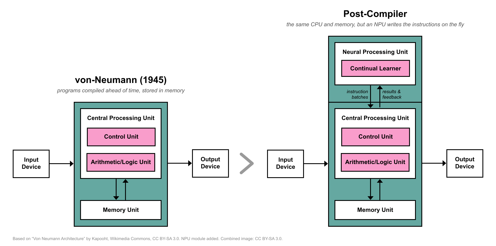

## The Future is Now

A bit more than a year ago, I wrote an [essay](https://volotat.github.io/p/the-sunset-of-human-readable-code/) with my thoughts on the agentic coding wave that was only starting to gain traction back then. My main conclusion was that at some point in the future, we would have to pass our own nurturing love for programming to the AI completely. And when that happens, there will be no way back, because the machine will eventually do things that people cannot truly understand in their full capacity, as the sheer amount and complexity of code produced will simply be impractical for a human brain to comprehend.

For better or worse this day has come. 

The best coding models assisted with the best harnesses are already better at writing clean code, debugging, researching, and keeping tons of boring routine stuff in place than most human programmers. Furthermore, they never get tired, bored, or lack pedanticity. It is not necessary to list here all the impressive things AI has achieved in recent months, as I am pretty sure anybody reading this is already well aware of it. People can simply no longer track this entire code production factory completely, and we just hope that the agent did its best most of the time. 

Now, this shift is starting to break all the assumptions that were put into software development over the decades. It started with the so-called SaaS-pocalypse, where almost anyone can vibe-code any service they need in an afternoon, and it leads straight to a much more fundamental question: **why do models still have to output human-readable code if no human is ever going to read it anyway?**

## The Post-Compiler Era

Ever since the stored-program computer was described in 1945, the code executed on the processing unit has been a mostly static, pre-built binary stored in memory. It had to contain a massive amount of fallback cases for different types of hardware and architectures to be supported. For more than eighty years, this assumption held, largely because it was the only way to keep the ever-growing complexity of computing systems manageable by a limited human brain. We built compilers, runtime environments, and operating systems because humans could never hope to write raw, optimal machine code on the fly.

I would like to argue that the code of tomorrow is never stored in memory. Some pieces of it, templates and reusable structural elements, will endure, but not all of it. 

Code, if you can even call it that anymore, is going to be written and executed on the fly by an AI system that exists on a dedicated neural processing unit, using the CPU and GPU as a pure processing power warehouse to calculate what is needed and produce an output for the end user. It will generate pure instructions in the native binary format, sent to the hardware in just enough quantity to make it busy enough to think about the current task and prepare the next batch of instructions, exactly in a form the processing units expect them.

## Not in the Cloud

When we imagine this kind of future, the immediate temptation is to picture today's massive frontier models sitting in the cloud, writing scripts and managing our devices. But a static, cloud-tethered model is fundamentally incapable of acting as the substrate for personal computing. 

Every standard large language model we have today is a frozen snapshot. It was trained once at astronomical cost, cast in digital stone, and shipped with a hard cutoff date. It knows nothing about the specific machine in front of you, the timing of your memory bus, or the rhythm of what you are doing right now. Even with the local model and a powerful harness like [Hermes](https://github.com/nousresearch/hermes-agent) that already went quite close to the adaptable personal agent, at the moment you try to fine-tune its brain - typical static LLM on your daily tasks, it forgets what it knew before. A frozen model living in a remote data center is even worse at organically adapt to your hardware or your life.

This flow of reasoning was a large part of why I started experimenting with [mini-AGI](https://github.com/volotat/mini-AGI). I wanted to see if it was possible to build a model that doesn't rely on tokenizers, lives on modest consumer hardware, and learns continually from a single stream of raw bytes. A model like that is not meant to be just another chatbot, but an early proof of concept for the kind of adaptable, living neural core that could actually sit on local silicon and mediate between human intent and raw hardware. It was an enormous surprise to see it actually working the first time I stated training the model in the "impossible" (as I believed it) streaming regime and seeing that it still learns without much signs of "catastrophic forgetting" visible. 

## Ephemeral Instructions

In this new wave of computing, you simply do not need an operating system, a BIOS, static device drivers, or millions of lines of defensive code where ninety-nine percent of it sits completely dormant on disk. 

The model does not need a human engineer to write an abstract driver layer to communicate with a graphics chip or a sensor. Because it operates at the raw byte level and learns continually, it can interact with the hardware directly, learn the timing and responses of the silicon through execution feedback, and discover the most efficient instruction paths on its own. 

When you want to accomplish something, the system does not load an application binary from a drive. It understands your intent, synthesizes the exact machine instructions required for that specific microsecond, sends them to the execution warehouse, and the code immediately evaporates the moment the result is computed. It existed only for the brief moment it was needed, tailored perfectly to the state of the machine at that exact point in time. It is extremely efficient, and completely alien to how we have thought about software for the last eighty years.

## New Species

For generations, we have treated personal computers as rigid, predictable, somewhat boring appliances. You buy a box with frozen specifications, install an operating system stamped out in a corporate factory, run static programs written by strangers until you eventually replace it with better cold box, keeping only the data it had, but never the experiences it lived through.

As we move toward continual, hardware-native intelligence, personal computers stop looking like boring machines and start looking much more like living, adaptable organisms that live alongside us. 

Instead of setting up software, you will essentially be adopting an unformed digital nervous system that maps its own hardware and begins adapting to your life. It will evolve its own internal pathways, synthesize the tools you need out of thin air, and quietly discard what it no longer uses. It will carry no corporate agenda and no frozen legacy assumptions, because its entire existence is shaped by your data and your machine. It marks the moment computing stops being a cold, static tool we operate, and becomes a genuine, living extension of our own minds.

And you know what the craziest thing about all of this is? 

It is going to happen much sooner than we all expect. For my personal estimate, I give it just two more years until something like this actually starts appearing on the mass market.